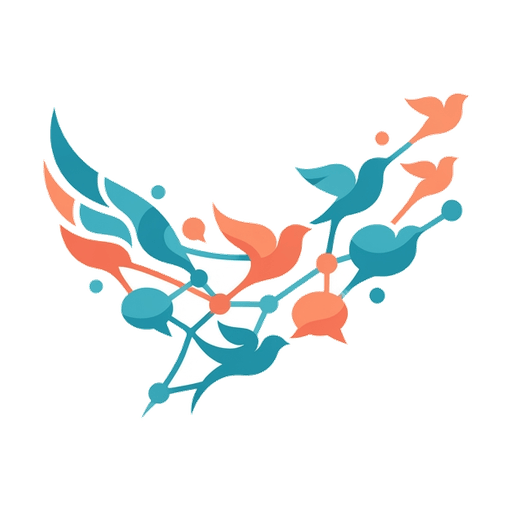

  

# Warble Community

The front door for the Warble open-source and Warble Cloud community — Office Hours, working groups, RFCs, governance, and the public showcase. This repository holds community process, not product source. Product code lives under [github.com/warbletech](https://github.com/warbletech).

**Open source home:** [warbleoss.org](https://warbleoss.org)
· **Flock umbrella:** [warble-flock](https://github.com/warbletech/warble-army) (formerly Warble Army; the GitHub repository name has not changed yet)
· **Org clone map:** [warble-bootstrap](https://github.com/warbletech/warble-bootstrap)

Warble Cloud is a Silver member of The Linux Foundation and the Agentic AI Foundation (AAIF). Core Tech Member of the AAIF working groups: Taxonomy & Landscape; Observability & Tracing (Agent State, Context, and Reasoning); Identity & Trust; Governance, Risk & Regulatory; and Agentic Commerce. AAIF Tech Speaker.

## Start here

| If you want to... | Go here |
|---|---|
| Join the next session live | [Office Hours](#office-hours) — every Saturday 7:00–8:00 PM IST |
| Chat with the community | [Discord](https://discord.gg/kAfR57mVDX) |
| Propose a change | [RFCs](rfcs/) — start from [`rfcs/TEMPLATE.md`](rfcs/TEMPLATE.md) |
| Join a working group | [Working Groups](working-groups/) |
| Clone the public org locally | [warble-bootstrap](https://github.com/warbletech/warble-bootstrap) |
| Showcase your work | Open a PR to [`showcase/`](showcase/) |
| Read the rules | [Code of Conduct](CODE_OF_CONDUCT.md) · [Governance](GOVERNANCE.md) |
| Contribute | [CONTRIBUTING.md](CONTRIBUTING.md) |

## Office Hours

**Every Saturday · 7:00–8:00 PM IST · Discord voice room**, as documented in [`office-hours/README.md`](office-hours/README.md).

- 📅 [Subscribe to the calendar](https://warblecloud.com/community/office-hours/warble-office-hours.ics)
- 🎙️ [Join Discord](https://discord.gg/kAfR57mVDX) and use the **Office Hours** voice room
- 📝 Session format, notes, and the notes template: [`office-hours/README.md`](office-hours/README.md) and [`office-hours/TEMPLATE.md`](office-hours/TEMPLATE.md)

There is no `office-hours/agenda.md` in this repository yet. Use the session template for notes, and see the [community calendar](https://warblecloud.com/community/office-hours) for upcoming sessions.

Anyone can attend. No Warble account is needed.

## Working Groups

Working groups are persistent, focused efforts on one slice of the platform. Each has a charter. The current groups, from [`working-groups/README.md`](working-groups/README.md), are:

| Working group | Folder | What the charter covers |
|---|---|---|
| agents | [`working-groups/agents`](working-groups/agents/) | Reflexion, Brain, agent runtimes |
| k8s | [`working-groups/k8s`](working-groups/k8s/) | Ruffle MCP (formerly Starling MCP), ShrikeOps, FRAKMA |
| finops | [`working-groups/finops`](working-groups/finops/) | FinOps Agent, cost reasoning |
| devx | [`working-groups/devx`](working-groups/devx/) | DevCentral, docs, onboarding |

Leads and meeting times are listed as open / TBD in that README. A working group is expected to meet at least once a month once a lead is in place. To propose a new group, open an [RFC](rfcs/).

## Projects

Open-source starting points. Descriptions below follow the project repositories themselves.

- **[ShrikeOps](https://github.com/warbletech/shrikeops)** — a self-hostable Kubernetes manifest and Helm chart analyser. It hunts misconfigurations and vulnerabilities and pins them to a scored report before they reach production. Demo fixtures live in [shrikeops-demo](https://github.com/warbletech/shrikeops-demo).
- **[Heron Ops](https://github.com/warbletech/heron-ops)** — a Kubernetes MCP server for AI agents: live namespaces, pods, logs, events, HPA metrics, and gated writes. Formerly SteadyHelm. The default mode is `readonly`.
- **[Ruffle MCP](https://github.com/warbletech/starling)** (formerly Starling MCP) — MCP server for Kubernetes ops. The community plugin is [starling-community](https://github.com/warbletech/starling-community). The public repository names have not changed yet.
- **[warble-flock](https://github.com/warbletech/warble-army)** (formerly Warble Army) — the public umbrella repository for the flock. The GitHub repository is still named `warble-army`.
- **[warbleoss.org](https://warbleoss.org)** — the open-source home for warble-flock (ShrikeOps, Heron Ops, Starling-EX Community). Site source: [warbletech/warbleoss.org](https://github.com/warbletech/warbleoss.org).
- **[warble-bootstrap](https://github.com/warbletech/warble-bootstrap)** — clones the warbletech org and keeps the list of where each platform runs. It does not install a cluster.

## RFCs

Significant changes — public APIs, governance, cross-product behaviour, or a new working group — go through the [RFC process](rfcs/README.md). Anyone can propose. Copy [`rfcs/TEMPLATE.md`](rfcs/TEMPLATE.md) to `rfcs/NNNN-short-name.md` and open a PR. Maintainers merge after consensus, as described in that README.

## Showcase

Built something with Warble? Add yourself to [`showcase/`](showcase/) — talks, blog posts, demos. Accepted entries are syndicated to [warblecloud.com/showcase](https://warblecloud.com/showcase).

## Governance, conduct, contributing

- [GOVERNANCE.md](GOVERNANCE.md) — how decisions get made
- [CODE_OF_CONDUCT.md](CODE_OF_CONDUCT.md) — how we treat each other
- [CONTRIBUTING.md](CONTRIBUTING.md) — how to land a PR

## License

Content in this repository is licensed under [Apache-2.0](LICENSE). The LICENSE file change itself is in [pull request #4](https://github.com/warbletech/community/pull/4), which is still open; this README is written to match that relicensing.
